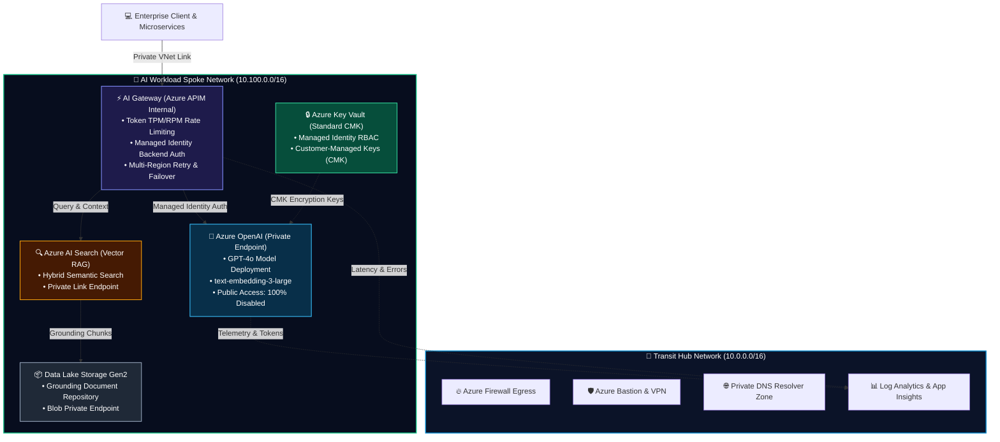

# 🤖 Azure Enterprise AI & GenAI Landing Zone (Terraform)

[](https://github.com/sanjiivsingh/azure-enterprise-ai-landing-zone-terraform/actions/workflows/ci-cd.yml)
[](https://www.terraform.io/)
[](https://registry.terraform.io/providers/hashicorp/azurerm/latest)
[](https://www.checkov.io/)
[](docs/EVIDENCE.md)
[](COMPLIANCE.md)
[](LICENSE)

> **Reference Architecture · Statically Validated**  
> Enterprise Generative AI Landing Zone engineered on Microsoft Azure using modular Terraform. Implements a Zero-Trust perimeter, private networking, Azure OpenAI model deployments (GPT-4o & Embeddings), API Management as an internal AI Gateway with token rate limiting, Azure AI Search vector database for Enterprise RAG, and automated DevSecOps pipelines. Detailed verification logs are provided in [docs/EVIDENCE.md](docs/EVIDENCE.md) and architectural decisions in [docs/ARCHITECTURE.md](docs/ARCHITECTURE.md).

---

## 🏛️ Architecture Overview



---

## 🎯 Key Architectural Pillars

### 1. 🛡️ Zero-Trust Network Perimeter (100% Private Endpoints)
* **Zero Public Exposure**: `public_network_access_enabled = false` enforced across Azure OpenAI, Azure AI Search, Azure Key Vault, and Data Lake Storage.
* **Micro-Segmented Subnets**:
  * `snet-ai-private-endpoints` (`10.100.1.0/24`): Dedicated isolated network space for Private Links.
  * `snet-apim-gateway` (`10.100.2.0/24`): Internal VNet injection for API Management.
  * `snet-app-workload` (`10.100.3.0/24`): Application tier consumption.
* **Private DNS Zones**: Seamless internal FQDN resolution via `privatelink.openai.azure.com`, `privatelink.search.windows.net`, `privatelink.vaultcore.azure.net`, and `privatelink.blob.core.windows.net`.

### 2. ⚡ AI Gateway via Azure API Management (APIM)
* **Token Rate Limiting**: Enforces strict Tokens-Per-Minute (TPM) and Requests-Per-Minute (RPM) quotas per consumer application to mitigate unexpected cost spikes and DoS attacks.
* **Zero Long-Lived Keys**: Consumer apps authenticate via Entra ID; APIM forwards requests to Azure OpenAI using its **System-Assigned Managed Identity**.
* **Circuit Retry & Fallback**: Automated retry on HTTP 429 rate limit or 5xx backend errors with exponential backoff.
* **Semantic Caching Architecture**: Policy XML supports response caching; requires an external Azure Cache for Redis connection in production.

### 3. 🧠 Azure OpenAI Model Deployments
* **GPT-4o**: Multimodal generative AI model provisioned with configurable capacity allocations.
* **text-embedding-3-large**: High-dimensional semantic embeddings for enterprise document retrieval.

### 4. 🔍 Azure AI Search (Vector Database for Enterprise RAG)
* Enterprise RAG (Retrieval-Augmented Generation) vector index pairing vector representations with keyword matching.
* Backed by Azure Data Lake Gen2 storage with private endpoints.

### 5. 🔒 Key Vault & Banking-Grade Governance
* **Key Vault Standard SKU**: Customer-Managed Key (CMK) envelope encryption; soft-delete and purge protection enabled; access restricted via Azure RBAC.
* **Compliance Mapping**: Documented in [COMPLIANCE.md](COMPLIANCE.md) against CIS Azure Foundations Benchmark v2.0 and NIST SP 800-53 controls.

---

## 📂 Repository Structure

```text
azure-enterprise-ai-landing-zone-terraform/
├── architectures/
│   └── ai-landing-zone-architecture.svg
├── modules/
│   ├── network/                      # Spoke VNet, Subnets, NSGs & Route Tables
│   ├── openai/                       # Azure OpenAI, Model Deployments & Private Endpoint
│   ├── ai_gateway_apim/              # APIM AI Gateway with XML policy integration
│   │   └── policies/
│   │       └── ai-gateway-policy.xml # Token Rate Limiting & Managed Identity XML Policies
│   ├── ai_search/                    # Azure AI Search Vector Store & Private Endpoint
│   ├── key_vault/                    # Azure Key Vault Standard & Private Endpoint
│   ├── storage/                      # Azure Storage Data Lake Gen2 for RAG Grounding
│   └── telemetry/                    # Log Analytics & Application Insights
├── environments/
│   ├── dev/                          # Development Environment Root Module
│   └── prod/                         # Production Environment Root Module
├── docs/
│   ├── ARCHITECTURE.md               # Architectural Decision Records (ADRs)
│   └── EVIDENCE.md                   # Static validation outputs & cost estimates
└── COMPLIANCE.md                     # CIS Azure Benchmark & NIST SP 800-53 Mapping
```

---

## 🚀 Local Initialization & Validation

```bash
cd environments/dev
terraform init -backend=false
terraform fmt -check
terraform validate
terraform plan -out=ai-landing-zone.tfplan
```

### Resource Teardown

```bash
terraform destroy -auto-approve
```

---

## 👨‍💻 Author & Cloud Architect

**Sanjeev Singh**  
*Senior Azure Cloud Architect & DevSecOps Platform Engineer*  
* 🌐 **Portfolio**: [sanjeevsingh.oneps.in](https://sanjeevsingh.oneps.in)  
* 💼 **LinkedIn**: [linkedin.com/in/sanjiivsingh](https://linkedin.com/in/sanjiivsingh)  
* 🐙 **GitHub**: [github.com/sanjiivsingh](https://github.com/sanjiivsingh)

---

## 📄 License
This project is licensed under the [MIT License](LICENSE).
