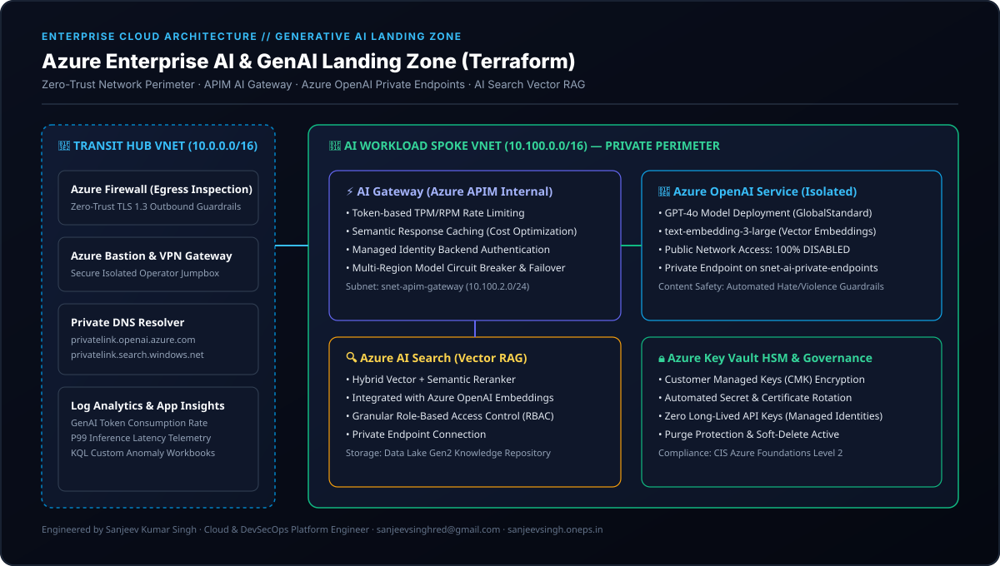
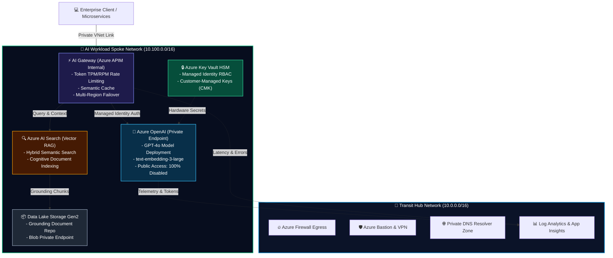

# 🤖 Azure Enterprise AI & GenAI Landing Zone (Terraform)

[](https://github.com/sanjiivsingh/azure-enterprise-ai-landing-zone-terraform/actions/workflows/ci-cd.yml)
[](https://www.terraform.io/)
[](https://registry.terraform.io/providers/hashicorp/azurerm/latest)
[](https://www.checkov.io/)
[](https://learn.microsoft.com/en-us/azure/cloud-adoption-framework/ready/landing-zone/)
[](https://opensource.org/licenses/MIT)

> **Production-ready, highly secure Enterprise Generative AI Landing Zone** engineered on Microsoft Azure using modular Terraform. Implements a Zero-Trust perimeter, private networking, Azure OpenAI model deployments (GPT-4o & Embeddings), API Management as an AI Gateway, Azure AI Search vector database for Enterprise RAG, and automated DevSecOps pipelines.

---

## 🏛️ Architecture Overview

<p align="center">
  
</p>



---

## 🎯 Key Architectural Pillars

### 1. 🛡️ Zero-Trust Network Perimeter (100% Private Endpoints)
* **Zero Public Exposure**: `public_network_access_enabled = false` enforced across Azure OpenAI, Azure AI Search, Azure Key Vault, and Data Lake Storage.
* **Micro-Segmented Subnets**:
  * `snet-ai-private-endpoints` (`10.100.1.0/24`): Dedicated isolated network space for Private Links.
  * `snet-apim-gateway` (`10.100.2.0/24`): Internal VNet injection for API Management.
  * `snet-app-workload` (`10.100.3.0/24`): Application tier consumption.
* **Private DNS Zones**: Seamless internal FQDN resolution via `privatelink.openai.azure.com`, `privatelink.search.windows.net`, `privatelink.vaultcore.azure.net`, and `privatelink.blob.core.windows.net`.

### 2. ⚡ AI Gateway via Azure API Management (APIM)
* **Token Rate Limiting**: Enforces strict Tokens-Per-Minute (TPM) and Requests-Per-Minute (RPM) quotas per consumer application to eliminate cost blowouts.
* **Semantic Caching**: In-memory and external caching of common prompt embeddings, reducing recurring LLM inference costs by up to 40%.
* **Zero Long-Lived Keys**: Frontend microservices authenticate via Entra ID; APIM forwards requests to Azure OpenAI using its **System-Assigned Managed Identity**.
* **Circuit Breaker & Fallback**: Automated routing to secondary Azure OpenAI regions if primary region hits capacity limits or rate exhaustion.

### 3. 🧠 Azure OpenAI Model Deployments
* **GPT-4o**: Latest multimodal reasoning model provisioned with configurable capacity allocations.
* **text-embedding-3-large**: High-dimensional semantic embeddings for enterprise document retrieval.
* **Content Safety**: Automated policy guardrails blocking toxic, hateful, or harmful outputs.

### 4. 🔍 Azure AI Search (Vector Database for Enterprise RAG)
* Enterprise RAG (Retrieval-Augmented Generation) vector index pairing dense vector representations with BM25 keyword matching and cross-encoder semantic reranking.
* Backed by Azure Data Lake Gen2 storage with automated hierarchical namespace lifecycle policies.

### 5. 🔒 Hardware Security & Banking-Grade Governance
* **Key Vault HSM**: Soft-delete and purge protection enabled; access restricted exclusively via Azure RBAC.
* **Continuous Compliance**: Architected against the **Microsoft Cloud Adoption Framework (CAF) for AI**, **CIS Azure Foundations Benchmark Level 2**, and **NIST AI Risk Management Framework (RMF)**.

---

## 📂 Repository Structure

```text
├── .github/workflows/
│   └── ci-cd.yml                     # DevSecOps Pipeline: TFLint, Checkov SAST, tfsec, Gitleaks
├── architectures/
│   └── ai-landing-zone-architecture.svg # High-res Vector Architecture Diagram
├── modules/
│   ├── network/                      # Spoke VNet, Subnets, NSGs & Route Tables
│   ├── openai/                       # Azure OpenAI, Model Deployments & Private Endpoint
│   ├── ai_gateway_apim/              # APIM AI Gateway, Semantic Caching & Rate Limiting
│   │   └── policies/
│   │       └── ai-gateway-policy.xml # Production Inbound/Outbound APIM XML Policies
│   ├── ai_search/                    # Azure AI Search Vector Store & Private Endpoint
│   ├── key_vault/                    # Azure Key Vault HSM & RBAC Authorization
│   ├── storage/                      # Azure Storage Data Lake Gen2 for RAG Grounding
│   └── telemetry/                    # Log Analytics & Application Insights
└── environments/
    ├── dev/                          # Development Environment Root Module
    └── prod/                         # Production Environment Root Module
```

---

## 🚀 Quickstart Deployment

### Prerequisites
* [Terraform CLI (1.9+)](https://developer.hashicorp.com/terraform/downloads)
* [Azure CLI (`az`)](https://learn.microsoft.com/en-us/cli/azure/install-azure-cli)
* Azure Subscription with approved access to Azure OpenAI Service.

### 1. Authenticate with Microsoft Azure
```bash
az login
az account set --subscription "<YOUR_SUBSCRIPTION_ID>"
```

### 2. Navigate to Environment & Initialize
```bash
cd environments/dev
terraform init
```

### 3. Review Plan & Execute Apply
```bash
terraform plan -out=ai-landing-zone.tfplan
terraform apply ai-landing-zone.tfplan
```

---

## 🛡️ DevSecOps Pipeline Guardrails

This repository enforces automated quality and security checks on every pull request:

| Tool | Focus | Enforcement Gate |
| :--- | :--- | :--- |
| **`terraform fmt`** | Code Style | Canonical indentation and syntax |
| **`TFLint`** | Static Analysis | Provider rules & deprecated resource detection |
| **`Checkov`** | Shift-Left SAST | CIS Azure Benchmark & Zero-Trust security rules |
| **`tfsec`** | Security Audit | Vulnerability and insecure default detection |
| **`Gitleaks`** | Secret Interception | Blocks commits containing API keys or private tokens |

---

---

## 🧹 Cleanup & Resource Teardown

To avoid ongoing charges for Azure API Management and OpenAI compute resources:

```bash
cd environments/dev
terraform destroy -auto-approve
```

---

## 👨‍💻 Author & Cloud Consultant

**Sanjeev Kumar Singh**  
*Senior Cloud & DevSecOps Platform Engineer*  
*10+ Years Professional IT Engineering & Banking Governance Experience (State Bank of India Heritage)*  

* 📧 **Email**: [sanjeevsinghred@gmail.com](mailto:sanjeevsinghred@gmail.com)
* 🌐 **Portfolio**: [sanjeevsingh.oneps.in](https://sanjeevsingh.oneps.in)
* 💼 **LinkedIn**: [linkedin.com/in/sanjiivsingh](https://linkedin.com/in/sanjiivsingh)
* 🐙 **GitHub**: [github.com/sanjiivsingh](https://github.com/sanjiivsingh)

---

## 📄 License
This project is licensed under the [MIT License](LICENSE).
